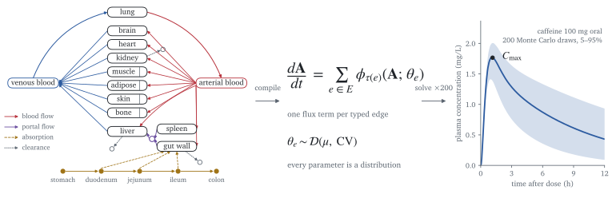
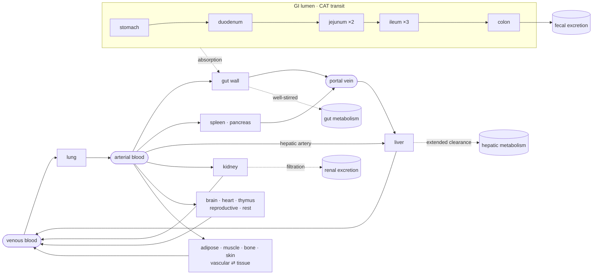
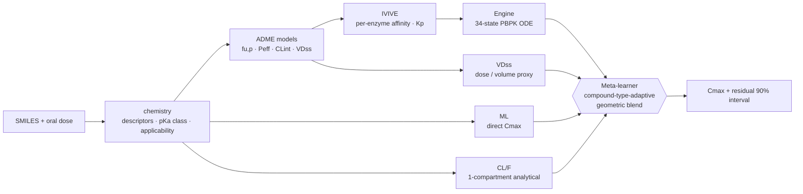

<div align="center">

# Sisyphus

**Structure-only oral C<sub>max</sub> prediction on a topology-compiled PBPK engine**

<picture>
  <source media="(prefers-color-scheme: dark)" srcset="docs/figures/hero-dark.svg">
  
</picture>

[](https://github.com/jam-sudo/Sisyphus/actions/workflows/ci.yml)
[](https://doi.org/10.26434/chemrxiv.15004452/v1)
[](pyproject.toml)
[](LICENSE)

[Overview](#overview)&emsp;[Quickstart](#quickstart)&emsp;[Method](#method)&emsp;[Evidence](#evidence)&emsp;[Architecture](#architecture)&emsp;[Limitations](#limitations)&emsp;[Citation](#citation)

</div>

Sisyphus predicts the peak plasma concentration (C<sub>max</sub>) of an oral drug from its structure and dose. The body is modeled as a typed directed graph: organs are nodes, and blood flow, portal drainage, GI transit, absorption, and clearance are edges. The engine compiles that graph into an ODE system and treats every parameter as a probability distribution; a meta-learner then blends the engine with three data-driven tracks into the production estimate.

> [!IMPORTANT]
> Current evidence is a repeatedly accessed retrospective development benchmark (Meta AAFE 2.825, N=73), not an independent holdout. Use Sisyphus for screening, ranking, and uncertainty-aware triage, not dose setting. Details are under [Evidence](#evidence).

## Overview

### Three ideas

1. **The body is a graph.** Organs are nodes; blood flow, GI transit, absorption, diffusion, and clearance routes are typed directed edges. The engine walks the graph, dispatches a flux function per edge type, and assembles the ODE right-hand side automatically. Extending the model means editing YAML, not the solver.
2. **Everything is a distribution.** All physiological and drug parameters are `Distribution(mean, cv, dist_type)` objects; a point estimate is `Distribution(mean=x, cv=0)`. Topology is compiled once and Monte Carlo iterations change only parameter values &mdash; 1,000 samples are one compilation plus 1,000 solves.
3. **The engine knows types, not identities.** Nothing in `engine/` matches on organ, enzyme, or drug names. Clearance at any node is computed from that node's enzyme abundances and the drug's per-enzyme affinities; replacing every organ name with a random string yields identical numerics.

### Scope

| Capability | Status | Module |
|:--|:--|:--|
| Oral structure-only C<sub>max</sub> | **Supported** &mdash; development-benchmarked | `pipeline/` |
| Engine T<sub>max</sub>, AUC, t<sub>&frac12;</sub>; conditional AUC∞ and IV CL/Vss | Experimental | `engine/`, `pk/` |
| Multi-dose regimen simulation | Experimental | `regimen/` |
| Bayesian TDM (SBI / IBIS / IS) | Experimental | `regimen/`, `sbi/` |
| Engine-as-prior posterior PK and MIPD | Research hypothesis | `mipd/` |
| Drug&ndash;drug interactions | Experimental | `ddi.py` |
| Pharmacogenomic phenotypes | Experimental | `predict/phenotype.py` |
| PK/PD effect compartment | Experimental | `pkpd.py` |

Experimental outputs are not covered by the C<sub>max</sub> accuracy claim and are not validated for clinical decisions; see [`docs/architecture/product_scope.md`](docs/architecture/product_scope.md). Residual/model-error and parameter-Monte-Carlo intervals are exposed separately.

## Quickstart

```bash
git clone https://github.com/jam-sudo/Sisyphus && cd Sisyphus
pip install -e ".[dev,ml]"
```

Requires Python &ge; 3.10 (numpy, scipy, and pyyaml for the core; rdkit, xgboost, and scikit-learn for prediction). Pre-trained XGBoost models for f<sub>u,p</sub>, P<sub>eff</sub>, CL<sub>int</sub>, VD<sub>ss</sub>, C<sub>max</sub>, CL/F, and Vd/F ship in `models/adme/` and `models/direct_pk/`; retraining scripts are in `scripts/`. Official metrics use the pinned `requirements-lock.txt` stack and the `public` resource profile ([reproducibility contract](docs/reproducibility.md)).

### Predict C<sub>max</sub>

```console
$ sisyphus predict --smiles "Cn1c(=O)c2c(ncn2C)n(C)c1=O" --dose 100

Drug: Cn1c(=O)c2c(ncn2C)n(C)c1=O
Method: hybrid
Execution: ok (public profile)
Applicability: no rule-based warning flags (confidence is not calibrated)
Final oral Cmax: <value> mg/L
Development empirical residual 90% interval: <low>–<high> mg/L
```

```python
from sisyphus.pipeline.predict import predict

result = predict("Cn1c(=O)c2c(ncn2C)n(C)c1=O", dose_mg=100.0)

print(result.cmax_prediction.cmax.mean)    # authoritative Meta Cmax
print(result.cmax_prediction.interval_90)  # development-residual interval
print(result.engine_simulation.endpoints)  # coherent engine-only endpoints
print(result.execution_status)             # "ok" / explicit fallback status
print(result.in_applicability_domain)      # rule-based flags, not calibrated accuracy
```

Doses are parent active-moiety mass. For a 500 mg metformin hydrochloride tablet, pass **389.93 mg** with the parent metformin SMILES; the [product label](https://dailymed.nlm.nih.gov/dailymed/drugInfo.cfm?setid=552ad61d-bafd-478d-e063-6294a90a02f9) states that equivalence.

<details>
<summary><b>Experimental research commands</b></summary>

```bash
# Multi-dose regimen simulation (atorvastatin 40 mg QD × 14 days)
sisyphus simulate --smiles "CC(C)C1=C(C(=C(N1CC[C@H](C[C@H](CC(=O)O)O)O)C2=CC=C(C=C2)F)C3=CC=CC=C3)C(=O)NC4=CC=CC=C4" \
    --dose 40 --interval 24 --doses 14

# TDM Bayesian update (midazolam 5 mg, observed 0.015 mg/L at t=1 h)
sisyphus tdm --smiles "CC1=NC=C2N1C3=C(C=C(C=C3)Cl)C(=NC2)C4=CC=CC=C4F" \
    --dose 5 --obs "1.0:0.015"

# DDI prediction (midazolam + ketoconazole inhibition)
sisyphus ddi --smiles "CC1=NC=C2N1C3=C(C=C(C=C3)Cl)C(=NC2)C4=CC=CC=C4F" \
    --dose 5 --inhibitor ketoconazole

# Engine-as-prior MIPD update from measured oral bioavailability
sisyphus mipd --smiles "Cn1c(=O)c2c(ncn2C)n(C)c1=O" \
    --dose 100 --measured-f 0.8

# MIPD dose recommendation (target Css,max = 0.02 mg/L)
sisyphus dose-adjust --smiles "CC1=NC=C2N1C3=C(C=C(C=C3)Cl)C(=NC2)C4=CC=CC=C4F" \
    --dose 5 --obs "1.0:0.015" --target-css 0.02

# Development benchmark (add --compute-pi for empirical 90% PI coverage; diagnostic only)
sisyphus benchmark --development-set
```

All commands accept `--verbose` for debug-level logging.

</details>

<details>
<summary><b>Driving the engine directly</b> &mdash; known compound parameters, ODE solve, Monte Carlo</summary>

For validation or mechanistic studies, the engine can be driven from compound YAML files, bypassing ADME prediction:

```python
from pathlib import Path
import numpy as np
from sisyphus.graph.builder import build_from_yaml
from sisyphus.compounds import load_compound
from sisyphus.engine.compiler import ODECompiler, ResolvedParams
from sisyphus.engine.solver import solve
from sisyphus.pk.endpoints import compute_endpoints
import sisyphus.engine.flux  # register flux functions

graph = build_from_yaml(Path("data/physiology/reference_man.yaml"))
drug = load_compound(Path("data/compounds/midazolam.yaml"))

compiled = ODECompiler().compile(graph)
rng = np.random.default_rng(42)
params = ResolvedParams(graph.sample(rng), drug.sample(rng))

y0 = np.zeros(compiled.n_states)
y0[compiled.state_index[drug.administration_node]] = drug.dose_mg

result = solve(compiled, params, y0, t_span=(0, 24))
pk = compute_endpoints(result)
print(f"Cmax: {pk.cmax.mean:.4f} mg/L")  # ~0.0028 mg/L (post FLUX-1 + RBP-2)
```

Monte Carlo propagation reuses the compiled skeleton:

```python
from sisyphus.engine.uncertainty import UncertaintyEngine

mc = UncertaintyEngine().propagate_fast(compiled, graph, drug, n_samples=1000)
print(mc.pk.cmax)            # Distribution(mean≈0.0030, cv≈0.22)
print(mc.cmax_90ci)          # (0.0018, 0.0040) mg/L
print(len(mc.cmax_samples))  # 1000 individual realizations
```

</details>

## Method

### Physiological graph

The reference body is a 34-compartment directed multi-graph: three blood pools (arterial, venous, portal), eleven perfusion-limited organs, four permeability-limited organs each split into vascular and extravascular sub-compartments, eight GI lumen segments following the compartmental absorption and transit model (Yu &amp; Amidon, 1999), and four mass-balance sinks. Physiological parameters follow ICRP Reference Man (ICRP, 2002), tissue compositions follow Rodgers et al. (2005) and Rodgers &amp; Rowland (2006), and CYP abundances follow Shimada et al. (1994). The YAML builder rejects any topology whose non-lung flow fractions do not sum to one.



### Flux equations

Each edge type dispatches one flux function. Perfusion-limited transport (`FlowFluxSpec`):

$$\frac{dA_i}{dt} = Q_i \cdot C_{in} - Q_i \cdot \frac{A_i \cdot R_{B:P}}{V_i \cdot K_{p,i}}$$

Clearance is **enzyme-level**: an organ's intrinsic clearance is the sum over the enzymes it carries, so the same equation serves liver, gut wall, or any node with an enzyme slot (Houston, 1994; Yang et al., 2007):

$$CL_{int,organ} = \sum_j \left( E_j \cdot k_j \right) \cdot S_{IVIVE}, \qquad CL_{organ} = \frac{Q \cdot f_u \cdot CL_{int,organ}}{Q + f_u \cdot CL_{int,organ}}$$

where $E_j$ is the enzyme abundance in the organ (pmol), $k_j$ the per-enzyme intrinsic clearance (&mu;L/min/pmol), and $S_{IVIVE}$ converts units (60/10<sup>6</sup>, &mu;L/min &rarr; L/h).

<details>
<summary><b>Hepatic extended clearance model, permeability-limited distribution, absorption, partitioning</b></summary>

**Hepatic clearance &mdash; extended clearance model (ECM, default)** (`ClearanceFluxSpec`, `model="extended"`). The QSSA-derived effective intrinsic clearance, with $PS_{inf,total} = PS_{inf} + J_{max} \cdot f_u / (K_m + f_u \cdot C_{u,hep})$:

$$CL_{int,eff} = \frac{PS_{inf,total} \cdot CL_{int,h}}{PS_{eff} + CL_{int,h}}$$

is embedded in the well-stirred form:

$$CL_{h} = \frac{Q \cdot f_u \cdot CL_{int,eff}}{Q + f_u \cdot CL_{int,eff}}$$

where $PS_{inf}$ is passive sinusoidal influx, $PS_{eff}$ sinusoidal efflux, $J_{max}/K_m$ the active-uptake (OATP1B1, &hellip;) Michaelis&ndash;Menten parameters, and $CL_{int,h}$ the sum of metabolic and biliary intrinsic clearance. It follows from the steady-state hepatocyte mass balance $PS_{inf,total} \cdot C_{u,blood} = (PS_{eff} + CL_{int,h}) \cdot C_{u,hep}$ and reduces to the classical well-stirred form for drugs without active transporter kinetics (Shitara et al., 2013; Yoshikado et al., 2017).

**Permeability-limited distribution** (`DiffusionFluxSpec`):

$$\frac{dA_{vasc}}{dt} = Q \cdot C_{art} - Q \cdot C_{vasc} - PS \cdot (C_{u,vasc} - C_{u,tissue})$$

$$\frac{dA_{tissue}}{dt} = PS \cdot (C_{u,vasc} - C_{u,tissue})$$

**GI absorption** (`AbsorptionFluxSpec`):

$$k_a = \frac{2.88 \cdot P_{eff} \cdot f_{ka}}{r}$$

where $P_{eff}$ is effective permeability (&times;10<sup>&minus;4</sup> cm/s), $f_{ka}$ the segment-specific absorption fraction, and $r$ the particle radius (&mu;m). The coefficient 2.88 is an empirical absorption-scale parameter for these numerical input units; it carries the units needed to produce h<sup>&minus;1</sup> and is not a dimensionless cm/s-to-&mu;m/h conversion. Its transferability across formulations has not been independently established.

**Tissue:plasma partition coefficients** use the full Rodgers &amp; Rowland equations (Rodgers et al., 2005; Rodgers &amp; Rowland, 2006), with extracellular/intracellular water, lipid, acidic phospholipid, and extracellular protein terms. The former aggregated approximation is available as `kp_method="rodgers_rowland_approx"` for comparison. `kp_method="berezhkovskiy"` uses the [modified Poulin equation](https://gastroplus.slp-software.com/scientific-principles-guide/GPX.2/tissue-distribution-calculations) with the Poulin–Theil tissue binding estimate and a tissue:plasma albumin ratio of 0.5; the old scalar correction has been removed.

The full tissue fractions are the rat values published by Rodgers and Rowland, applied here to the human reference graph as in [Coutinho et al. (2024), Table III](https://pmc.ncbi.nlm.nih.gov/articles/PMC11196289/). `gut_wall` uses gut; adipose, bone, muscle, and skin map to their corresponding `_tissue` nodes. The source tables omit acidic phospholipid concentrations for pancreas and thymus, so those use liver and spleen values respectively. The aggregate `reproductive` and `rest` nodes use muscle composition. The blood:plasma input comes from `drug.rbp`; when no measurement is supplied, its documented population default is 1.0. Hematocrit comes from the physiology graph.

</details>

### Prediction pipeline



1. **SMILES &rarr; molecular profile.** RDKit descriptors, structural pK<sub>a</sub> classification, and applicability-domain assessment.
2. **ADME prediction.** XGBoost models for f<sub>u,p</sub>, P<sub>eff</sub>, CL<sub>int</sub>, and VD<sub>ss</sub> trained on public TDC datasets (Huang et al., 2021); R<sub>B:P</sub> defaults to 1.0. DrugBank experimental enrichment exists only in the opt-in `licensed_research` profile and never affects public results.
3. **IVIVE.** CL<sub>int</sub> is decomposed into per-enzyme affinities, and tissue Kp values are computed.
4. **Four C<sub>max</sub> tracks.**

| Track | Signal |
|:--|:--|
| **Engine** | 34-state PBPK ODE solved with LSODA (Petzold, 1983) |
| **ML** | XGBoost direct C<sub>max</sub> (906 hash-pinned public clinical PK rows derived from Omega MMPK data) |
| **CL/F** | Closed-form one-compartment C<sub>max</sub> from XGBoost CL/F and V<sub>d</sub>, with k<sub>a</sub> from engine T<sub>max</sub> / P<sub>eff</sub>; decorrelates from Engine and ML residuals through different input channels |
| **VDss** | Dose divided by predicted VD<sub>ss</sub> for a fixed 70 kg body &mdash; a scale estimate, not an absorption/elimination model; included whenever a positive VD<sub>ss</sub> estimate exists |

5. **Meta-learner.** A compound-type-adaptive geometric blend with weights selected by LOOCV on the repeatedly accessed N=107 development set: bases use Engine 0.60 / ML 0.40 / CL/F 0.00; other compounds use Engine 0.35 / ML 0.50 / CL/F 0.15. When the VDss track activates it takes weight 0.20 and the other three are scaled by &times;0.80. The VDss routing was selected on N=107 and is not an independently validated applicability rule. These weights are frozen pending blinded external evaluation.

### Uncertainty propagation

Monte Carlo sampling draws realizations from parameter distributions, including configured correlated enzyme abundances, solves the ODE for each, and aggregates the PK endpoints into distributional summaries. IV infusion also has a parameter-only C<sub>max</sub> interval. The parameter-only Monte Carlo interval and the user-facing development-residual interval are reported separately; their calibration status is described under [Limitations](#limitations).

### Research modules

These modules reuse the engine without modifying it. They are experimental and outside the C<sub>max</sub> accuracy claim.

<details>
<summary><b>Multi-dose regimens</b> &mdash; event-driven solver, steady-state detection</summary>

An event-driven solver wraps the single-dose ODE engine. Dose events are injected into the state vector between integration segments; the ODE right-hand side is not modified, which preserves the identity-blind engine while supporting arbitrary schedules (repeated oral, IV infusion, mixed regimens).

Steady state is declared when trough variation falls below 5% across the last three dosing intervals. The solver reports C<sub>ss,max</sub>, C<sub>ss,min</sub>, the accumulation ratio (AR = C<sub>ss,max</sub> / C<sub>max,first</sub>), and the dose number at which steady state is reached.

</details>

<details>
<summary><b>Therapeutic drug monitoring</b> &mdash; dispatched SBI / IBIS / IS posterior update</summary>

Given observed plasma concentrations, a **dispatched Bayesian router** (`data/sbi/method_routing.json`) refines population-level parameter distributions into individual posteriors with one of three methods per drug:

- **SBI (simulation-based inference).** A neural spline flow proposes parameter samples. For each proposal inside the box prior, eight independent physiology and drug realizations estimate the Cmax observation likelihood by averaging Gaussian densities; importance weights include the box prior divided by the proposal density. A 5% prior mixture protects the proposal tails. The implementation tries 256, 512, then 1,024 proposals until correction ESS reaches 32; outside-prior proposals need no ODE solves, and an attempt with fewer than 32 supported proposals cannot meet the ESS floor. Low ESS after all retries falls back to IBIS. The likelihood estimate is unbiased; finite importance resampling still has Monte Carlo error. Raw flow sampling is available only through the explicit `sbi_raw_npe=True` API flag. The router uses SBI for a validation drug or covariate pair only when its SBC has no exact-rejection, joint SMC, or uncomputable cases and none of its KS or coverage tests is rejected by the flow-wide combined Holm check at family-wise α=0.01. This exploratory routing check was amended after corrected multi-drug results were visible; the unchanged per-row pass remains informational.
- **IBIS (iterative Bayesian importance sampling).** Fallback when a drug fails that routing rule or correction ESS is low; closed-loop iteration prevents weight degeneracy.
- **IS (classical importance sampling).** Retained for legacy compatibility where explicitly routed.

The raw-flow correction pilot on four fixed synthetic observations found K=8 ESS of 24.9–28.0 at 64 proposals, below the floor of 32. At 256 proposals, morphine and ketorolac reached ESS 78.6 and 81.1; K=4 used half as many ODE solves but reached ESS 56.2 and 69.8. Against 200 exact joint-prior rejection draws per drug, the absolute error in the mean logit-fup parameter fell from 1.15 to 0.40 for morphine and from 0.72 to 0.39 for ketorolac when moving from 64 to 256 proposals at K=8. Mean errors are not monotone across K on this single seed and include Monte Carlo error in the reference; see `data/validation/sbi_importance_pilot.json`. On one hard sildenafil observation, 50 repeated unbiased likelihood estimates had log-estimate variance 194,032 at K=8 and 38,652 at K=64 at the generating parameter; K=64 costs eight times as many solves and still leaves severe noise. See `data/validation/sbi_pm_likelihood_variance.json`.

In the five-drug TDM tournament rerun, the corrected SBI route completed as SBI for four drugs and fell back to IBIS for diclofenac after 1,024 proposals remained below the ESS floor. Its median wall time was 1,617 seconds versus 4,054 seconds for direct IBIS; mean absolute Cmax bias against the supplied observations was 44.4% versus 32.5%. Ketorolac needed the 1,024-proposal retry and took 5,350 seconds, longer than direct IBIS. Diclofenac's correction reached ESS 2.0 and its fallback took 6,503 seconds. The SBI route used 200 prior particles, including on fallback, versus 2,000 for direct IBIS, so the timings are not matched-budget comparisons. These are research timing and fit diagnostics, with no claim of clinical calibration. Clozapine was skipped because the benchmark has no holdout Cmax reference for it. See `data/validation/tdm_method_tournament_corrected.json`.

Effective sample size (ESS = $1/\sum w_i^2$) is reported for the corrected proposal; low ESS after all retries triggers the IBIS fallback. SBC uses exact joint-prior rejection when correction is under the ESS floor; selected blocks also use direct exact rejection. For cases where bounded rejection cannot collect 500 draws, the post hoc recovery samples the joint parameter and nuisance posterior by adaptive-tempering SMC with 1,000 particles, a 50% incremental ESS target, and two rejuvenation sweeps per stage. This targets the explicit Gaussian observation likelihood with the simulator nuisance prior; finite particles and limited rejuvenation leave approximation error. On a tractable pravastatin case, its three parameter marginals agreed with an exact rejection reference (two-sample KS p = 0.292, 0.414, 0.069), using 9,260 versus 16,384 simulator evaluations. A hard sildenafil pilot had only 36 distinct initial ancestors after tempering; cases below 100 automatically rerun with 4,000 particles and three rejuvenation sweeps, and remain incomplete if the enlarged run is still below the floor. The single-case comparison does not certify every drug. Exact-rejection and joint-SMC cases are recorded separately and excluded from SBI routing. See `data/validation/sbi_joint_smc_policy.json` and `data/validation/sbi_joint_smc_reference.json`. A production IBIS fallback remains outside the SBC-validated sampler. IBIS does not condition on population, age, or weight covariates, and the result warns when that fallback occurs. All three methods share one output contract: a posterior `Distribution` per PK parameter. Observed drug levels can update errors in the current CL<sub>int</sub> predictor (scaffold-CV R&sup2; = 0.215). The previously reported raw-flow calibration counts and TDM timing do not describe the corrected production sampler.
For two or three observations, a time-aware flow can condition on observation times, concentrations, and dosing regimen where `use_native` is set in the routing table. Its corrected likelihood multiplies the per-observation Gaussian terms within each shared physiology and drug realization before averaging across realizations. The time-aware path requires equal oral bolus doses (up to three) and observations 1, 2, 4, 8, or 12 hours after the last dose. While corrected multi-observation SBC is pending, automatic routing and the default SBI update use IBIS for multiple observations.

Explicit population-class SBI uses a hierarchical flow and the requested population physiology graph in the correction and posterior prediction. A validated population–drug pair excluded by the same combined Holm and sampler-behavior rule falls back to IBIS with a warning.

With `--method sbi` and both body weight and age supplied, TDM uses the continuous-covariate flow and generates a physiology graph for those covariates at 43 of the 52 validated population–drug pairs. The other nine pairs fall back to IBIS with a warning under the same pair-level sampler-behavior and combined Holm rule. Corrected SBC results for completed flows are reported in their validation artifacts; the routing table marks unfinished flows as pending. Under independent exact calibrated ranks, the unchanged global gate passes 10.62% for either 39-test flow, 0.88% for 78 tests, and 9.35% for 156 tests. A supplementary Holm–Bonferroni KS gate at family-wise α=0.01, with the same 0.10 coverage tolerance, passes 14.52%, 1.85%, and 41.07%, respectively. A second supplementary gate combines the same KS p-values with exact binomial coverage p-values in one Holm family; it passes 98.99%, 99.22%, and 98.86%, respectively (10,000 simulations per gate shape). The combined gate was specified before full aggregation, after some corrected multi-drug results were visible, and is used only for exploratory routing. These null probabilities assume independent parameter and pair ranks; cross-parameter rank dependence can change them. Using exact rejection posterior draws from three synthetic drug contexts retains their joint parameter dependence: the same unchanged gate passes 10.32% (95% CI 9.73–10.93%) for 39 tests, 1.08% (0.89–1.30%) for 78, and 8.20% (7.67–8.76%) for 156. This supplementary simulation still samples cases and pairs independently and cannot cover all drug and covariate contexts. See `data/validation/sbi_global_gate_policy.json`, `data/validation/sbi_global_gate_null.json`, and `data/validation/sbi_global_gate_exact_reference_null.json`.

The completed corrected multi-drug SBC **fails the unchanged global gate**: 9 of 13 drug rows pass, four exceed the 0.10 coverage tolerance, and all 39 marginal KS p-values exceed 0.01. The supplementary size-calibrated full-set gate passes with zero rejections among 195 combined KS and coverage tests; its exact-rank null pass probability is 98.99%. The production-scope gate passes with zero rejections among 165 tests on 11 eligible drugs; its null pass probability is 99.98%. Pravastatin's 100 exact-rejection cases and sildenafil's five joint-SMC cases are ineligible under the corrected routing rule. See `data/validation/sbi_sbc_multi_drug_corrected.json`.

The corrected hierarchical SBC also **fails the unchanged global gate**: 20 of 26 population–drug pairs pass, with six per-row failures. Its supplementary size-calibrated full-set gate passes with zero rejections among 390 tests; the production-scope gate passes with zero rejections among 300 tests on 20 eligible pairs. Exact posterior rank simulations put the unchanged 78-test gate's pass probability at 1.08% (95% CI 0.89–1.30%) for a calibrated sampler. See `data/validation/sbi_sbc_hierarchical_corrected.json`.

The corrected continuous-covariate SBC **fails the unchanged global gate**: 51 of 52 pairs pass, with elderly digoxin exceeding the 0.10 coverage tolerance (deviation 0.133); all 156 marginal KS p-values exceed 0.01. The supplementary Holm KS gate also fails on coverage. The combined size-calibrated full-set gate passes with zero rejections among 364 KS and coverage tests; its independent-rank null pass probability is 98.86%. The production-scope gate passes with zero rejections among 301 tests on 43 eligible pairs; its null pass probability is 99.81%. Exact posterior rank simulations put the unchanged 156-test gate's pass probability at 8.20% (95% CI 7.67–8.76%) for a calibrated sampler. See `data/validation/sbi_sbc_continuous_corrected.json`.

</details>

<details>
<summary><b>Model-informed precision dosing</b> &mdash; linear dose scaling and engine-as-prior posterior PK</summary>

**Linear dose scaling.** MIPD recommends an adjusted dose for a target steady-state concentration:

1. A Bayesian update at the observed dose yields a posterior C<sub>ss</sub> distribution.
2. $dose_{new} = dose_{current} \times (C_{ss,target} / C_{ss,posterior})$
3. The result is clamped to the clinical dose range and rounded to a practical increment (default 25 mg).

Linear scaling assumes non-saturable metabolism. The legacy `regimen/` dosing API rejects drugs with declared saturable enzyme kinetics unless the caller explicitly opts into an experimental override. The separate `mipd/` dose search evaluates candidate regimens under its posterior; neither path is clinically validated.

**Engine-as-prior posterior PK (`mipd/`).** This module explores the mechanistic engine as a structural prior updated by measured concentrations. Bioavailability F is one candidate latent, because formulation, salt or crystal form, food, particle size, and transporter genetics are absent from the SMILES input; it can be given a wide prior centered on the engine's emergent F<sub>engine</sub> and updated by sampling/importance-resampling (SIR). The current experiments do not show that one observation identifies F or corrects all sources of structural error.

The module provides an a-priori-to-posterior path (`predict_posterior`), steady-state TDM with renal and optional structural latents (`predict_tdm`), covariate individualization (measured or Cockcroft&ndash;Gault creatinine clearance; body weight and age through a physiology-generator graph swap), and target-attainment dose recommendation (`recommend_dose`, with `forward_dose_search` for structural posteriors). The `sisyphus mipd` CLI exposes these research workflows. `predict_posterior` uses grid SIR by default; `method="neural"` uses the trained flow as a 50% mixture importance proposal, corrects draws with the grid-SIR prior and likelihood, and falls back to grid SIR when proposal ESS is below 200. The corrected path passed the strict heldout agreement gate, but its flow density evaluation was slower than grid SIR in the measured benchmark.

> This module is a research hypothesis. Synthetic/simulator validation does not establish real-patient predictive accuracy, clinical utility, or calibrated posterior intervals.

</details>

<details>
<summary><b>Drug&ndash;drug interactions</b> &mdash; enzyme-abundance perturbation before compilation</summary>

DDI adjusts enzyme abundances in the body graph before ODE compilation; the engine computes clearance as usual.

$$E_{eff} = \frac{E_{base}}{1 + [I] / K_i} \quad \text{(competitive inhibition)}, \qquad E_{eff} = E_{base} \cdot \frac{k_{deg}}{k_{deg} + k_{inact}[I]/(K_I + [I])} \quad \text{(static time-dependent inhibition)}, \qquad E_{eff} = E_{base} \cdot \left(1 + \frac{E_{max} \cdot [I]}{EC_{50} + [I]}\right) \quad \text{(induction)}$$

where $E_{base}$ is baseline enzyme abundance (pmol), $[I]$ the unbound perpetrator concentration (total concentration multiplied by `fu_perpetrator`), $K_i$ the competitive inhibition constant, $k_{inact}$ and $k_{deg}$ rates in h<sup>&minus;1</sup>, $K_I$ in µM, and $E_{max}$/$EC_{50}$ the induction parameters. The factors multiply when mechanisms are combined. TDI uses a fixed perpetrator concentration and user-supplied enzyme-specific parameters; it does not simulate perpetrator exposure or enzyme turnover over time. Preset perpetrators: ketoconazole, fluconazole, quinidine (CYP inhibitors) and rifampin (CYP3A4 inducer).

```python
from sisyphus.ddi import apply_inhibition, KETOCONAZOLE

inhibited_graph = apply_inhibition(graph, KETOCONAZOLE)
# Mechanistic scenario only; external clinical-pair validation is required.
```

```sh
sisyphus ddi --smiles 'CCO' --dose 100 --inhibitor ketoconazole
sisyphus ddi --smiles 'CCO' --dose 100 --tdi-enzyme CYP3A4 \
  --kinact 0.2 --ki-tdi 1 --kdeg 0.1 --concentration 1
```

The second command is an illustrative parameter scenario, not a validated drug pair. Add `--competitive-ki` for competitive inhibition by the same perpetrator, `--fu-perpetrator` for unbound concentration, or `--inducer rifampin` to apply induction as well. The Python API accepts per-enzyme `(kinact, KI, kdeg)` tuples via `Inhibitor(enzyme_tdi=..., mechanism="time_dependent")`.

</details>

<details>
<summary><b>PK/PD link</b> &mdash; effect compartment with sigmoid E<sub>max</sub></summary>

Effects are computed from the concentration&ndash;time profile as analytical post-processing, not additional ODE states:

$$\frac{dC_e}{dt} = k_{e0} \cdot (C_p - C_e), \qquad E = E_0 + \frac{E_{max} \cdot C_e^n}{EC_{50}^n + C_e^n}$$

where $k_{e0}$ is the effect-site equilibration rate constant (h<sup>&minus;1</sup>), $E_0$ the baseline effect, and $n$ the Hill coefficient. Presets cover midazolam (sedation) and warfarin (INR response).

```python
from sisyphus.pkpd import compute_effect, PDModel

effect = compute_effect(sim_result, PDModel(ke0=0.5, emax=100.0, ec50=0.05, hill=2.0))
```

```sh
sisyphus pkpd --smiles 'CCO' --dose 100 --ke0 0.5 --ec50 0.05
```

The CLI uses the `PDModel` defaults for E<sub>max</sub>, Hill coefficient, and baseline, and reports peak effect and its time. Choose `ke0` and `ec50` for the drug and endpoint; use the Python API for other effect parameters. This is an experimental scenario, not a clinical prediction.

</details>

## Evidence

Sisyphus targets oral structure-only Cmax prediction when measured ADME is unavailable. On the repeatedly accessed retrospective **development benchmark**, Meta AAFE is 2.825 [bootstrap 95% CI 2.31&ndash;3.49, N=73 scored]. This is not an independent holdout result: the original 107-compound cohort has informed repeated system-selection decisions. A source-adjudicated diagnostic P0 pilot on 18 compounds, scored with an earlier model, found Meta AAFE **3.34**, compared with **3.01** for direct ML; its labels were AI-assisted, historical VDss training membership is unverified, and it does not establish Meta superiority. The current system has **no unconsumed independently curated external holdout AAFE**. Error of this scale and the wide development-residual interval (&divide;&times;~9.36-fold; 89.0% coverage on the repeatedly used development set) restrict the tool to screening, ranking, and uncertainty-aware triage, not dose setting.

Each evaluation is listed with the model it scored and its consumption status, including unfavorable results.

| Evaluation | N | Meta AAFE | Direct-ML AAFE | Status |
|:--|:-:|:-:|:-:|:--|
| [Retrospective development benchmark](#retrospective-development-benchmark) | 73 | **2.825** | 3.049 | Current model; repeatedly accessed |
| Consumed temporal challenge (FDA NMEs 2024&ndash;2025) | 28 | 3.286 | &mdash; | 2026-07-05 engine; consumed |
| P0 source-adjudicated pilot | 18 | 3.34 | 3.01 | Earlier model; diagnostic |
| P1 AI-assisted blind diagnostic | 7 | 6.63 | 5.25 | Earlier public model; development-grade |
| P2 FDA acquisition check | 0 eligible of 248 | &mdash; | &mdash; | No predictions run |
| External Holdout V1 | &mdash; | &mdash; | &mdash; | [Protocol](docs/validation/external_holdout_v1_protocol.md) only |

### Retrospective development benchmark

Retrospective evaluation on a Murcko scaffold-stratified development split (107 compounds, seed=42; 73 currently have source-supported scored Cmax). All seven active fitted models have SHA-pinned public training snapshots with compound-level exclusions, but this cohort has been used for repeated weight, track, routing, and mechanism feedback and therefore is not an independent system holdout. It integrates observed concentration&ndash;time profiles from OSP, curated literature PK data, and FDA DailyMed labels, with mixed formulations and populations. Bootstrap confidence intervals are conditional on the selected system and do not include adaptive model-selection bias.

$$AAFE = 10^{\operatorname{mean}\left(\left|\log_{10}\frac{C_{max,pred}}{C_{max,obs}}\right|\right)}$$

| Track | AAFE | 95% CI | %2-fold | %3-fold | N |
|---|:-:|:-:|:-:|:-:|:-:|
| **Meta-learner (production)** | **2.825**† | [2.31, 3.49] | 39.7% | 61.6% | 73 |
| Engine only | 4.654 | [3.45, 6.43] | 30.1% | 46.6% | 73 |
| ML only | 3.049 | [2.47, 3.78] | 41.1% | 57.5% | 73 |
| Meta, in-domain | 2.762 | [2.29, 3.38] | 37.3% | 62.7% | 59 |

The paired compound-bootstrap Meta/ML AAFE ratio is **0.927** (95% CI **0.816–1.047**, 10,000 resamples, seed 20260422); the in-domain ratio is 0.998 (0.894–1.119). These conditional intervals do not account for repeated system selection, and the development data cannot establish independent Meta superiority. The in-domain N=59 slice is descriptive only: applicability flags have not demonstrated reliable error stratification.

**Reference and training-label audit (2026-09-24/25).** Before the current scores were produced, every scored development arm and the direct-model training aggregates were re-checked against original sources. The audit removed 165 synthetic or arm-mixed concentration profiles; quarantined untraceable, multi-day, steady-state, prodrug-metabolite, and whole-blood labels; replaced digitized or mixed-arm peaks with directly reported single-dose fasted arms where available; and converted salt-form doses to parent active-moiety mass. Per-compound decisions, sources, and hashes are in the dated `development_*` notes under [`docs/validation/`](docs/validation/), starting from the [reference source audit](docs/validation/development_reference_source_audit_2026-09-24.md). A subsequent metadata-level source-consistency filter for the direct C<sub>max</sub> training set was a no-go (3.5% higher out-of-fold AAFE; [ablation](docs/research/cmax_source_consistency_ablation_2026-09-25.md)), so the production model is unchanged.

**Reproducibility.** The table uses public-only TDC f<sub>u,p</sub>, P<sub>eff</sub>, hepatocyte CL<sub>int</sub>, and Lombardo VD<sub>ss</sub> models plus Omega-derived C<sub>max</sub>, CL/F, and Vd/F retrains, fitted on 1,557 f<sub>u,p</sub>, 874 P<sub>eff</sub>, 906 C<sub>max</sub>, 995 CL<sub>int</sub>, 1,055 VD<sub>ss</sub>, 898 CL/F, and 829 Vd/F hash-pinned rows. Per-drug predictions are in `data/training/4track_holdout_predictions.json`; bootstrap intervals are in `data/validation/4track_ci_2026-10-29_canonical.json`. Aggregate AAFE reproduces from a fresh clone with `requirements-lock.txt`; per-drug bit-identity additionally requires the same numerics stack (Python minor version, BLAS, libomp). Benchmark lineage and numerics-drift measurements are in [`docs/research/experiment-log.md`](docs/research/experiment-log.md).

> [!WARNING]
> **Adaptive selection.** †N=107 has been used for dozens of configuration feedback cycles (track weights, routing, and meta variants), including inspection of the public-only fup, Peff, Cmax, CLint, and VDss candidates. The historical 2.85–3.10 selection-bias sensitivity range has not been recalibrated for this model, and the current N=73 bootstrap CI ([2.31, 3.49]) does not account for adaptive search. The attempted 2026Q2 N50 was invalidated after 21/50 repository-corpus collisions and must not be cited. The replacement is the outcome-blind N=260 protocol in [`docs/validation/external_holdout_v1_protocol.md`](docs/validation/external_holdout_v1_protocol.md) (N=120 resource-limited fallback; its combined release gate has about 80% pass probability only near a 19% true improvement).

### Diagnostic and consumed evaluations

<details>
<summary><b>Consumed temporal challenge</b> &mdash; FDA NMEs approved 2024&ndash;2025, N=28, Meta AAFE 3.286</summary>

Single-active-ingredient oral small molecules, production-clean at construction, re-scored on the 2026-07-05 engine. These predictions predate the public-only fup, Peff, Cmax, CLint, and VDss retrains, and the set has informed diagnosis, so it is no longer independent evidence for the current system.

| Slice | AAFE | 95% CI | %2-fold | %3-fold | N |
|---|:-:|:-:|:-:|:-:|:-:|
| All | 3.286 | [2.45, 4.48]† | 25.0% | 50.0% | 28 |
| In-domain | 3.318 | [2.12, 5.39]† | 37.5% | 50.0% | 16 |

On the 2026-07-05 system the temporal cohort was directionally worse than its same-version development benchmark (3.286 versus 2.743), reversing an earlier favorable N=15 reading. It was assembled as follows:

- **Decontaminated.** Three drugs that had leaked into production training were removed: vorasidenib (`clinical_pk.json` gold reference), and aficamten + gepotidacin (`clf_training.csv` → the CLF track, which has no prospective-exclusion filter). A production-aware gate (`scripts/check_prospective_eligibility.py`) now enforces this; it additionally rejected **9 of 26** newly discovered candidates as already in training (e.g. ensartinib in `holdout.json['train']`, deuruxolitinib in `clinical_pk.json`, 7 in `clf_training.csv`). Membership in non-production files that the pipeline never loads is not treated as contamination.
- **Expanded.** Exhaustive FDA-NME discovery (101 unique 2024–2025 NMEs across 3 cross-checked sources) → 37 new oral small-molecule candidates → adversarial per-drug Cmax verification (FDA label / EMA EPAR / peer-reviewed PK, ≥2 independent sources agreeing within ~1.5×). Excluded with reasons: 4 verification failures, 7 combination products, 9 production-contaminated, 1 prodrug (sepiapterin, parent-Cmax fold ~3000). 16 added.

The same-machine re-score moved Meta AAFE 3.208 → 3.286 and Engine AAFE 4.302 → 4.551, while the direct ML track was bit-identical. This supports an absorption/first-pass error diagnosis but does not establish a statistically separated generalization gap. †Compound bootstrap, 100,000 resamples of absolute log-fold error, seed 20260422; diagnostic because the set is consumed. Artifact: `data/validation/prospective_N28_current_engine_2026-07-05.json`.

</details>

<details>
<summary><b>P0 source-adjudicated pilot</b> &mdash; N=18, Meta 3.34 vs direct ML 3.01</summary>

This pilot used the earlier DrugBank-trained fup artifact, so its scores do not measure the current public-only model. All 186 frozen candidates were reviewed against original PK sources before the sealed predictions were opened. Eighteen compounds (58 arms) met the source rules; 47 were excluded and 121 remain unresolved. Compound-cluster Meta AAFE was **3.34** (95% bootstrap CI 2.43–4.79), versus **3.01** (2.26–4.18) for direct ML. The paired Meta/ML ratio was **1.11** (95% CI 0.93–1.34); only 33.3% of compounds were within twofold for Meta. These results do not show Meta superiority. Source eligibility was AI-assisted with coordinator checks, and the clarification of eligibility rules followed first-pass viewing of source Cmax values. Two scored compounds occur in the current VDss fitted snapshot; the earlier model's fitted-row membership cannot be reconstructed. This is diagnostic development evidence, not External Holdout V1 or a clinical release gate. See the [P0 result](docs/validation/self_run_p0_result.md) for hashes, exclusions, and remaining source uncertainty.

</details>

<details>
<summary><b>P1 AI-assisted blind diagnostic</b> &mdash; N=7, Meta 6.63 vs direct ML 5.25</summary>

Eight previously unseen compounds were source-screened by a separate AI-assisted worker, and anonymous inputs and predictions were committed before their Cmax labels were opened. On this small, nonconsecutive, **development-grade** set, a second source review found that one of the eight labels was **whole-blood** Cmax, not plasma. Excluding that arm, frozen-prediction Meta AAFE is **6.63** (95% compound-bootstrap CI 3.10–13.84, N=7), versus **5.25** (2.22–13.97) for direct ML; the paired Meta/ML ratio is **1.26** (0.90–1.75). These post-label diagnostic values are a serious error signal, not a population accuracy estimate or a proof of track inferiority. Immediate-release and active-moiety dose evidence is incomplete, one paper has an inconsistent capsule strength, and two independent human curators were unavailable. No P1 arm qualifies for External Holdout V1. See the [P1 diagnostic](docs/validation/blind_p1_result_2026-09-24.md) for the freeze chain, source cells, sensitivity, and limitations.

</details>

<details>
<summary><b>P2 FDA acquisition check</b> &mdash; 248 oral FDA NMEs screened, none eligible</summary>

A separate AI-assisted worker consecutively screened all **248 oral FDA NME rows from 2015–2025** against the repository exclusion union and strict original-arm criteria. No new eligible compound remained, so no predictions were run. Repository name collisions removed 235 rows; the two structure-clean parents that reached original-source arm review lacked stated post-dose meal timing. A follow-up found an explicit oral-solution arm for one parent but no matching post-dose fasting statement; both exposed identities are now excluded from a future blinded cohort. This is a single-agent acquisition check, not External Holdout V1 evidence; the [P2 screen](docs/validation/blind_p2_fda_acquisition_2026-09-24.md) records ordered attrition and limitations. A qualifying external cohort needs other source windows and independent human curation.

</details>

### Engine and research-module checks

<details>
<summary><b>Engine verification</b> &mdash; Omega parity and post-correction regression snapshots</summary>

Four drugs with known compound parameters are simulated end-to-end (YAML &rarr; BodyGraph &rarr; compile &rarr; solve &rarr; C<sub>max</sub>). They originally matched the [Omega PBPK](https://github.com/jam-sudo/Omega) engine (35-state hardcoded model) to within ~0.5%, but Omega shared two physiological bugs that Sisyphus has since corrected:

- **FLUX-1** (2026-06-03): a flow-limitation double-count that capped hepatic/gut extraction at E&rarr;0.5. Moves high-extraction drugs (midazolam, propranolol).
- **RBP-2** (2026-06-04): a blood:plasma concentration-basis correction (whole-blood pools reported on a plasma basis). Moves any drug with R<sub>B:P</sub> &ne; 1 (midazolam 0.66, warfarin 0.58, propranolol 0.81).

Only **caffeine** (R<sub>B:P</sub>=1, low extraction) remains a true cross-engine parity check. The other three are Sisyphus self-consistency regression snapshots &mdash; their divergence from Omega *is* the correctness fix. Values are pinned in `tests/integration/test_engine_validation.py` (&plusmn;5% gate; targets carry documented macOS&harr;CI numerics-stack drift).

| Drug | Dose | Sisyphus C<sub>max</sub> (mg/L) | Omega C<sub>max</sub> (mg/L) | Basis |
|:--|:-:|:-:|:-:|:--|
| Caffeine | 100 mg PO | 1.6910 | 1.7139 | Omega parity; invariant to both fixes (1.3%, macOS-stack drift) |
| Midazolam | 2 mg PO | 0.002800 | 0.006943 | Snapshot &mdash; FLUX-1 + RBP-2 |
| Warfarin | 10 mg PO | 0.343133 | 0.4922 | Snapshot &mdash; RBP-2 (FLUX-1 no-op, low extraction) |
| Propranolol | 80 mg PO | 0.059875 | 0.1355 | Snapshot &mdash; FLUX-1 + RBP-2 |

Mass-balance error is &lt; 10<sup>&minus;12</sup> for all simulations. Cross-engine parity is not a sufficient correctness oracle: both shared bugs survived as long as they did precisely because parity held.

</details>

<details>
<summary><b>Multi-dose regression checks</b> &mdash; three drugs against FDA-label steady state</summary>

| Drug | Regimen | Predicted C<sub>ss,max</sub> (mg/L) | FDA label C<sub>ss,max</sub> (mg/L) | Fold error |
|:--|:--|:-:|:-:|:-:|
| Atorvastatin | 40 mg QD | 0.070 | 0.029 | 2.42 |
| Metformin | 500 mg BID | 2.39 | 1.0 | 2.39 |
| Warfarin | 5 mg QD | 0.21 | 1.4 | 0.15 |

Regenerated on the current engine (post-FLUX-1 + paracellular) via `scripts/verify_v2.py`. Atorvastatin and metformin are each over-predicted by ~2.4×. The warfarin Cmax source was later quarantined for a dose/analyte mismatch, so that row is not current accuracy evidence. Predicted accumulation ratios tracked theory (metformin 1.11 vs 1.35; atorvastatin 1.50 vs 1.44; warfarin 1.81 vs 2.94) and steady-state detection operated correctly. This is a solver-mechanics and limitation-exposure exercise, not a multi-dose accuracy claim: each compound's single-dose error propagates into its steady-state estimate.

</details>

<details>
<summary><b>TDM regression checks</b> &mdash; importance-sampling baseline on synthetic observations</summary>

The multi-drug table below is an earlier **importance sampling** check on synthetic observations. Corrected SBI calibration and routing are reported separately in `data/validation/sbi_sbc_multi_drug_corrected.json` and `data/sbi/method_routing.json`. These checks do not establish clinical TDM validity.

> Morphine uses the adjudicated 22.5 mg / 28.5 ng/mL reference ([reference adjudication](docs/validation/reference_pmid_screen_2026-09-24.md)). The single-drug midazolam check below is historical and was not rerun in this update.

**Single-drug functional check** (midazolam, 5 mg PO, one observation at t = 1 h, 10% assay CV):

| Metric | Prior | Posterior |
|:--|:-:|:-:|
| C<sub>max</sub> CV | 44.3% | 19.8% |
| ESS | &mdash; | 586.6 (29.3% of 2,000) |
| CV reduction | &mdash; | 55.3% |

**Multi-drug benchmark** (5 selected drugs, synthetic observations scaled from engine C(t) profiles to observed C<sub>max</sub>, 10% log-normal assay noise, seed = 42):

| Drug | Type | 1-obs CV reduction | 2-obs CV reduction | 3-obs CV reduction | 1-obs ESS |
|:--|:-:|:-:|:-:|:-:|:-:|
| Morphine | base | 83.7% | 84.3% | 84.2% | 87.4 |
| Amantadine | base | 89.5% | 90.4% | 90.9% | 138.4 |
| Ketorolac | acid | 86.8% | 93.6% | 95.9% | 4.4 |
| Clozapine | neutral | 74.2% | 84.2% | 85.4% | 500.1 |
| Rivaroxaban | neutral | 94.2% | 96.5% | 97.0% | 5.0 |

Across all 15 runs (5 drugs &times; 3 observation scenarios): mean CV reduction 88.7%, mean error reduction 75.2%, and 90% CI coverage 60% (9/15). One-observation ESS is below 10 for ketorolac and rivaroxaban, indicating particle degeneracy despite narrow intervals. Timepoint sensitivity (morphine, one observation) gave the largest CV reduction at 1.0 h (83.0%); across three seeds the reduction ranged from 82.2% to 83.7% at N = 2,000 prior samples.

</details>

### Computational performance

| Operation | Time | Configuration |
|:--|:-:|:--|
| Full prediction (SMILES &rarr; C<sub>max</sub>) | 414 ms | Prior warm-run benchmark, deterministic, single core |
| ODE solve (full fidelity) | 106 ms | LSODA, rtol=10<sup>&minus;8</sup>, atol=10<sup>&minus;10</sup> |
| ODE solve (MC fast path) | 33 ms | LSODA, rtol=10<sup>&minus;4</sup>, atol=10<sup>&minus;6</sup> |
| MC N=1,000 | 33.5 s | Pure Python RHS (no JIT compilation) |
| RHS evaluation | 31 &mu;s | 54 flux specs per call |

First-call model loading and hardware change latency: a local macOS/Python 3.10 caffeine check on 2026-09-23 took 1.11 s on the first call and 0.16&ndash;0.17 s on five warm calls. JIT compilation (e.g. Numba) of the RHS is an unexplored optimization path.

### Test suite

The suite covers graph construction, ODE compilation, flux functions, solver correctness, mass balance, ADME prediction, the C<sub>max</sub> ensemble, dosing research modules, applicability flags, phenotype scaling, leakage guards, and development-benchmark reproducibility; CI output is the authoritative count. The current benchmark is pinned by `test_cached_development_aafe_is_2p825` and reproducible with `scripts/run_engine_benchmark.py` on the public profile. Three expected failures remain: rosuvastatin and atorvastatin miss their ECM-forced C<sub>max</sub> gates, and an axial PGx test deliberately retains a strict xfail because its well-stirred analytic oracle does not apply to parallel-tube extraction. Three prodrug clinical gates are also strict expected failures in the public clone because their conditional disposition data are absent, making six expected failures in total.

## Architecture

| Layer | Responsibility | Depends on |
|:--|:--|:--|
| `graph/` | BodyGraph, node/edge types, YAML builder | `core` |
| `engine/` | ODE compiler, flux registry (including ECM), solver, Monte Carlo | `core`, `graph` |
| `predict/` | SMILES &rarr; chemistry &rarr; ADME &rarr; DrugOnGraph, transporter DB | `core` |
| `ml/` | XGBoost C<sub>max</sub>, CL/F, VDss predictors, four-track meta-learner | `core` |
| `pk/` | SimResult &rarr; PKEndpoints (route-aware) | `core` |
| `pipeline/` | Orchestrator wiring all layers | all layers |
| `regimen/` | Multi-dose solver, TDM dispatch (SBI/IS/IBIS/EnKF), linear-scaling dose adjustment | `core`, `engine`, `graph`, `sbi` |
| `sbi/` | Simulation-based inference training, amortized posterior, physiology generator | `core`, `engine` |
| `mipd/` | Engine-as-prior posterior PK via SIR, covariate individualization, dose recommendation | `core`, `engine`, `graph`, `regimen`, `sbi` |
| `ddi.py` | Competitive and fixed-concentration time-dependent inhibition, E<sub>max</sub> induction | `core`, `graph` |
| `pkpd.py` | Effect compartment, sigmoid E<sub>max</sub> | `core` |

Layers import only their listed dependencies: `predict` does not import `engine`, `engine` does not import `predict`, and `regimen` wraps `engine` without modifying it. Shared data types live in `core.py`. The three data contracts &mdash; `DrugOnGraph` (predict &rarr; engine), `SimResult` (engine &rarr; pk), and `PredictionResult` (pipeline &rarr; caller) &mdash; are frozen dataclasses; `DrugOnGraph.enzyme_affinity` carries per-enzyme intrinsic clearance rather than organ-level CL<sub>int</sub>, so IVIVE happens inside the engine, organ-blind.

### Extending the model

New compartments, routes, populations, interaction models, and clinical workflows require **no changes to the ODE engine**. Subcutaneous injection, pediatric physiology, a tumor compartment, DDI, PK/PD, multi-dose regimens, and TDM were each added with zero lines changed in `src/sisyphus/engine/`.

```yaml
# A new organ: tumor compartment
nodes:
  - name: tumor
    type: organ
    volume: 0.05
    composition: {fn: 0.013, fp: 0.010, fw: 0.700, pH: 6.8}
edges:
  - {source: arterial_blood, target: tumor, type: flow, flow_fraction: 0.005}
  - {source: tumor, target: venous_blood, type: flow}
```

```python
# A new route: subcutaneous depot
graph.add_node(Node(name="sc_depot", node_type="lumen", volume=Distribution(0.01)))
graph.add_edge(AbsorptionEdge(source="sc_depot", target="venous_blood",
                               ka_fraction=Distribution(1.0)))
```

A new population is a parameter change on the same topology: the pediatric preset scales physiology allometrically (cardiac output &prop; BW<sup>0.75</sup>) and adjusts enzyme abundances for ontogeny (e.g. CYP3A4 at 50% of adult at age 5).

<details>
<summary><b>Repository layout</b></summary>

```
src/sisyphus/
├── core.py              # Distribution, TissueComposition, data contracts
├── descriptors.py       # Morgan fingerprints + RDKit descriptors
├── compounds.py         # Compound YAML → DrugOnGraph loader
├── ddi.py               # Drug-drug interaction modeling
├── pkpd.py              # PK/PD effect compartment + Emax
├── cli.py               # Cmax CLI + explicitly experimental research commands
├── resources.py         # Explicit public/licensed model-data profiles
├── graph/               # BodyGraph types, YAML builder (flow-conservation check), presets
├── engine/              # Identity-blind ODE compiler, flux specs, LSODA solver, Monte Carlo
├── predict/             # Chemistry, ADME, IVIVE, phenotype, prodrug + transporter registries
├── ml/                  # Direct PK predictors, CL/F track, model registry, meta-learner
├── pk/                  # Endpoints and non-compartmental analysis
├── regimen/             # Multi-dose solver, steady state, TDM (SBI/IBIS/EnKF), dosing
├── sbi/                 # Priors, simulator, neural posterior, physiology generator, SBC gate
├── mipd/                # F / CL / renal latents, covariates, posterior PK, dose recommendation
├── physiology/          # Correlated-physiology registry
├── validation/          # Reference loader, benchmark runner, AAFE / coverage metrics
└── pipeline/            # SMILES → PredictionResult orchestration

data/
├── physiology/          # BodyGraph YAML (reference man, pediatric, SC and tumor overlays)
├── compounds/           # Curated compound configurations
└── reference/           # Clinical PK reference data, development split

models/                  # Pre-trained XGBoost models (committed; ~31 MB)
docs/research/           # Experiment log, dead ends, accuracy diagnosis
docs/validation/         # Source audits and evaluation records
```

</details>

## Limitations

- **Stereoisomer discrimination is unvalidated.** The direct-ML track uses a chirality-blind Morgan fingerprint, so enantiomers with the same connectivity receive the same ML features. Curated full-InChIKey registries can distinguish specific structures, but their isomer-specific C<sub>max</sub> accuracy has not been independently tested.
- **Evaluated scope is narrower than the engine's route support.** The development C<sub>max</sub> claim concerns oral small-molecule parent drugs. Biologics and non-oral routes have no independent C<sub>max</sub> accuracy evaluation here.
- **Prodrug activation remains experimental.** The seven-substrate registry supports parent-to-active routing, but its three-drug clinical gate still fails (sepiapterin 4748&times;, tebipenem pivoxil 9.05&times;, fostamatinib 4.50&times; in the recorded v3 test). Prodrugs are flagged outside the applicability domain. Clopidogrel parent C<sub>max</sub> remains in the consumed development benchmark; that label does not validate active-metabolite prediction. See `CHANGELOG.md` for mechanism and version history.
- **Simplified pK<sub>a</sub>.** Ionization state is classified by structural rules (carboxylic acid &rarr; 4.5, aliphatic amine &rarr; 9.0), not computed quantum-mechanically. This limits Kp accuracy for highly ionized compounds.
- **Phase II metabolism is incomplete.** NAT2, UGT1A1, UGT1A9, and UGT2B7 have modeled abundances; SULT and other UGT routes remain unmodeled. Parent-drug exposure may be overpredicted when omitted pathways materially contribute to clearance, all else equal. The modeled pathway effects have not been independently validated for clinical dosing.
- **Transporter-mediated disposition: OATP1B1 only.** Hepatic uptake by OATP1B1 is modeled mechanistically via the ECM with per-drug kinetic parameters in `data/transporters/oatp1b1.json`. Other hepatic transporters (OATP1B3, NTCP, BSEP), intestinal transporters (P-gp, BCRP), and renal transporters (OAT1/3, MATE1/2-K) are not mechanistically modeled. P-gp efflux at the gut wall is approximated via a binary permeability correction.
- **ECM generalization is unverified for non-statins.** Under the current public profile, pravastatin, pitavastatin, and fluvastatin pass their numerical ECM-forced C<sub>max</sub> gates; rosuvastatin and atorvastatin remain expected failures. Fluvastatin is marked `ecm_applicable=false` in production because its CYP2C9-dominant clearance makes the ECM-forced result biologically inapplicable. A pre-registered generalization test on valsartan + glimepiride (2026-04-22, N=2) returned systematic 2.5× underprediction. The fup-override hypothesis was ruled out; J<sub>max</sub> calibration, Vss/Kp over-distribution, and ECM architectural limits for K<sub>m</sub> &gt; 1 µM substrates remain candidates. Do not rely on ECM accuracy for non-statin OATP1B1 substrates without independent verification.
- **CL<sub>int</sub> prediction is limited on the tested data.** The public-only XGBoost model achieved scaffold-CV R&sup2; = 0.215 on 995 TDC Hepatocyte_AZ compounds. Tested representation, dataset, and architecture changes did not reliably improve end-to-end C<sub>max</sub> on the repeatedly used development cohort. This does not prove an intrinsic R&sup2; ceiling or identify assay noise as the sole cause; see the [accuracy diagnosis](docs/research/diagnosis.md). TDM results are internal, observation-conditioned research and do not establish structure-only or clinical dosing accuracy.
- **R<sub>B:P</sub> defaults to 1.0.** The RBP model (R&sup2; = &minus;0.08 on external data) is effectively disabled; all drugs are assumed to have equal blood and plasma concentrations.
- **Novel-drug underprediction has an unresolved mechanism.** Some 2024&ndash;2025 compounds were severely underpredicted in a consumed prospective diagnostic set. The earlier claim that F alone caused these errors is withdrawn: the cited oral CL/F is apparent clearance, not systemic CL, and the ten-drug literature-F comparison mixed incompatible endpoints. Low predicted F and engine&harr;ML divergence did not provide a useful error flag in the tested sets. A matched human oral/IV study and an untouched C<sub>max</sub> cohort are needed to distinguish F, clearance, formulation, and other causes; see [diagnosis &sect;8](docs/research/diagnosis.md) and the [F source audit](docs/validation/f_reference_source_audit_2026-09-24.md).
- **Error cancellation constrains component-level improvements.** Development experiments show strong residual correlation among many blending variants and sensitivity to compensating ADME errors. This does not prove the current blend is optimal. Further selection on N=107 would deepen adaptive overfitting; changes must be hypothesis-driven, trained without external labels, and judged once on the blinded external protocol. Negative experiments are catalogued in [`docs/research/dead-ends.md`](docs/research/dead-ends.md).
- **The 90% residual interval is not externally calibrated.** The parameter-only Monte Carlo interval covered only 29.9% of N=107 observations at nominal 90%. The user-facing Meta band is a much wider empirical residual quantile whose component predictions are not fully out-of-sample for its calibration records. It is shown only for the public, default-Kp, four-track oral path after its calibration cache and model hashes pass a first-use check; altered partition methods, licensed-profile predictions, track fallbacks, and stale artifacts have no such band. It is not a valid split-conformal guarantee. Independent calibration must use nested out-of-fold predictions or a separate untouched calibration cohort, followed by one-time evaluation on a different blinded holdout.
- **IV-C<sub>max</sub> observation convention.** For intravenous bolus dosing, engine C<sub>max</sub> is the maximum concentration over `t ≥ 5 min` rather than the instantaneous `t = 0` spike; oral drugs use the full-interval maximum. All 73 scored development compounds are oral, so this convention does not affect that AAFE; IV accuracy remains unvalidated.
- **Dose recommendation and TDM are experimental.** Linear dose scaling is rejected automatically for modeled saturable metabolism unless explicitly overridden. That guard prevents a known misuse but does not clinically validate MIPD, TDM, or any posterior interval.

## Lineage

Sisyphus inherits curated data assets from its predecessor, [Omega PBPK](https://github.com/jam-sudo/Omega) (591 commits), but not its architecture.

| Inherited (data) | Replaced (architecture) |
|:--|:--|
| 331-drug clinical reference | 35-state hardcoded ODE system |
| Scaffold-stratified development split | Organ-specific CL<sub>int</sub> fields |
| ICRP physiology values | Sequential ADME &rarr; IVIVE chain |
| Pre-trained XGBoost models | Point-estimate pipeline |
| Rodgers &amp; Rowland tissue compositions | Post-hoc hybrid selector |

Three Omega findings shaped the design: **data quality dominates model choice** (14 reference corrections reduced AAFE by 47.5% with no model changes); **gut CL<sub>int</sub> matters more than hepatic CL<sub>int</sub> for C<sub>max</sub>** (Sobol total-order indices 0.47 vs 0.00); and **a meta-learner beats a fixed ensemble** (feature importance: ML C<sub>max</sub> 50%, PBPK C<sub>max</sub> 26%).

## Citation

The published v1 preprint and archived `Sisyphus_Preprint.pdf` report an older AAFE of 2.698. The current code's source-screened development benchmark is 2.825 on 73 scored compounds; the value comes from a different model and reference set. Use [Evidence](#evidence) for current results.

If you use Sisyphus in your research, please cite the preprint:

```bibtex
@article{yoon2026sisyphus,
  author  = {Yoon, J. M.},
  title   = {Sisyphus: A Topology-Compiled Physiologically Based Pharmacokinetic
             Platform with Structure-Only Input and Bayesian Parameter Refinement},
  journal = {ChemRxiv},
  year    = {2026},
  doi     = {10.26434/chemrxiv.15004452/v1},
  note    = {Preprint}
}
```

and, for the software itself:

```bibtex
@software{yoon2026sisyphus_software,
  author  = {Yoon, J. M.},
  title   = {Sisyphus: Graph-based whole-body PBPK simulation with native
             uncertainty propagation},
  version = {0.4.0},
  year    = {2026},
  url     = {https://github.com/jam-sudo/Sisyphus}
}
```

The git tag `v1.0.0` (commit `d6ee9a6`) records an earlier feature-branch milestone that has been superseded by the current `main` line under a more conservative measurement regime; see `CHANGELOG.md`.

## References

- Berezhkovskiy, L. M. (2004). Volume of distribution at steady state for a linear pharmacokinetic system with peripheral elimination. *J Pharm Sci*, 93(6), 1628&ndash;1640.
- Houston, J. B. (1994). Utility of in vitro drug metabolism data in predicting in vivo metabolic clearance. *Biochem Pharmacol*, 47(9), 1469&ndash;1479.
- Huang, K., et al. (2021). Therapeutics Data Commons: Machine learning datasets and tasks for drug discovery and development. *NeurIPS Datasets and Benchmarks*.
- ICRP (2002). Basic anatomical and physiological data for use in radiological protection: reference values. *ICRP Publication 89*.
- Obach, R. S., et al. (1997). The prediction of human pharmacokinetic parameters from preclinical and in vitro metabolism data. *J Pharmacol Exp Ther*, 283(1), 46&ndash;58.
- Petzold, L. R. (1983). Automatic selection of methods for solving stiff and nonstiff systems of ordinary differential equations. *SIAM J Sci Stat Comput*, 4(1), 136&ndash;148.
- Poulin, P., &amp; Theil, F. P. (2002). Prediction of pharmacokinetics prior to in vivo studies. 1. Mechanism-based prediction of volume of distribution. *J Pharm Sci*, 91(1), 129&ndash;156.
- Rodgers, T., Leahy, D., &amp; Rowland, M. (2005). Physiologically based pharmacokinetic modeling 1: Predicting the tissue distribution of moderate-to-strong bases. *J Pharm Sci*, 94(6), 1259&ndash;1276.
- Rodgers, T., &amp; Rowland, M. (2006). Physiologically based pharmacokinetic modelling 2: Predicting the tissue distribution of acids, very weak bases, neutrals and zwitterions. *J Pharm Sci*, 95(6), 1238&ndash;1257.
- Rodgers, T., &amp; Rowland, M. (2007). Mechanistic approaches to volume of distribution predictions: Understanding the processes. *Pharm Res*, 24(5), 918&ndash;933.
- Shimada, T., et al. (1994). Interindividual variations in human liver cytochrome P-450 enzymes involved in the oxidation of drugs, carcinogens and toxic chemicals. *J Pharmacol Exp Ther*, 270(1), 414&ndash;423.
- Shitara, Y., Maeda, K., Ikejiri, K., Yoshida, K., Horie, T., &amp; Sugiyama, Y. (2013). Clinical significance of organic anion transporting polypeptides (OATPs) in drug disposition: their roles in hepatic clearance and intestinal absorption. *Biopharm Drug Dispos*, 34(1), 45&ndash;78.
- Yang, J., Jamei, M., Yeo, K. R., Tucker, G. T., &amp; Rostami-Hodjegan, A. (2007). Prediction of intestinal first-pass drug metabolism. *Curr Drug Metab*, 8(7), 676&ndash;684.
- Yoshikado, T., Toshimoto, K., Nakada, T., Ikejiri, K., Kusuhara, H., Maeda, K., &amp; Sugiyama, Y. (2017). Comparison of methods for estimating unbound intracellular-to-medium concentration ratios in rat and human hepatocytes using statins. *Drug Metab Dispos*, 45(7), 779&ndash;789.
- Yu, L. X., &amp; Amidon, G. L. (1999). A compartmental absorption and transit model for estimating oral drug absorption. *Int J Pharm*, 186(2), 119&ndash;125.

## License

Code is released under the [MIT License](LICENSE). Third-party datasets retain their original licenses.
